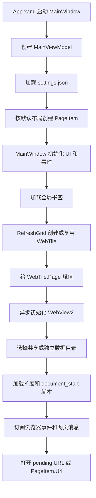

# 项目逻辑梳理

本说明记录 2026-10-17 首次梳理时的代码基线。后续已实现可调布局、工作区、独立运行/声音和定时刷新，并修复其中部分问题；最新行为和操作说明见 [当前功能说明](MultiplePagesBrowser/FEATURES.md)。下文保留作重构前的对照。

## 1. 项目定位和实际目录

这是一个 Windows 桌面多格浏览器：WPF 提供窗口和工具栏，WebView2 提供网页渲染，最多显示 16 个格子。没有后端服务或数据库，数据写入本机 JSON 和浏览器用户目录。

- 解决方案：`MultiplePagesBrowser.slnx`
- 项目：`MultiplePagesBrowser/MultiplePagesBrowser.csproj`
- 技术栈：`.NET 10 / WPF / Microsoft.Web.WebView2 1.0.3912.50`
- 启动和主窗口在项目根目录，Models、ViewModels、Controls、Views 位于项目内的另一层 `MultiplePagesBrowser/` 中。后文文件路径相对于项目目录。
- 根 README 只有项目名；较完整的功能说明在项目目录的 README，但部分描述与实现不一致。

## 2. 模块职责

| 模块 | 实际职责 |
| --- | --- |
| `App.xaml` | 通过 StartupUri 启动 MainWindow |
| `MainWindow.xaml(.cs)` | 工具栏、快捷键、网格重建、控件池、格子最大化、窗口协调、会话保存恢复 |
| `MultiplePagesBrowser/ViewModels/MainViewModel.cs` | 页面集合、当前激活页面、布局预设、URL 解析和导航分发 |
| `MultiplePagesBrowser/Models/PageItem.cs` | 单格状态：URL、标题、激活、静音、加载状态、独立用户目录 |
| `MultiplePagesBrowser/Controls/WebTile.cs` | 构建单格 UI，初始化 WebView2，执行导航、脚本、静音及后台优化，接收网页消息 |
| `MultiplePagesBrowser/Models/AppSettings.cs` | 设置及 JSON 读写 |
| `MultiplePagesBrowser/Models/BookmarkStore.cs` | 全局书签集合及 JSON 读写 |
| `MultiplePagesBrowser/Models/SessionData.cs` | 会话布局、URL 列表及 JSON 读写 |
| `MultiplePagesBrowser/Models/ExtensionManager.cs` | 扫描本地解压扩展、保存开关、尝试加载到 WebView2 Profile |
| `MultiplePagesBrowser/Models/UserScriptManager.cs` | 扫描 JS、解析脚本元信息、URL 匹配及启用配置 |
| `MultiplePagesBrowser/Views/` | 设置、书签、插件管理三个辅助窗口 |

整体是事件驱动的轻量 MVVM：ViewModel 管状态，但大量协调逻辑仍在窗口后台代码；导航历史操作直接从窗口调用控件，没有统一的命令层或服务层。

## 3. 最重要的三组状态

1. **页面状态**：`MainViewModel.Pages` 中的 PageItem，按索引对应格子。
2. **浏览器实例**：`MainWindow._tilePool` 按索引缓存 WebTile；每个 WebTile 持有一个 WebView2。
3. **当前显示范围**：`Columns × Rows` 决定显示前多少个页面，`_activeTiles` 记录这些可见格子的控件。

Pages 和控件池只增不减。例如先开 16 格再切 4 格，仍有 16 个 PageItem 和 WebTile，界面只放入前 4 个。隐藏不等于销毁，也不保证后台挂起成功。

`ActivePage` 代表当前操作对象。切换时将旧页面 IsActive 设为 false、新页面设为 true；PageItem 同时将 IsMuted 设置为 IsActive 的反值。因此“全部静音”是一次性赋值，之后切换激活格子会重新打开新激活格子的声音。

## 4. 启动流程



新建 PageItem 的 URL 固定是 `about:blank`，当前不会自动打开设置中的主页。主页设置仅由工具栏主页按钮读取。启动时也不会自动恢复上次会话，需要点击恢复按钮。

## 5. 导航的双向数据流

### 用户从界面发起

```text
地址栏 / 书签 / 粘贴
  → MainWindow 或 WebTile 接收操作
  → MainViewModel.NavigateActive / NavigateAll / NavigateMultiple
    或直接修改 PageItem.Url
  → PageItem.PropertyChanged
  → WebTile.Page_PropertyChanged
  → NavigateTo
  → CoreWebView2.Navigate
```

浏览器尚未就绪时，URL 放入 `_pendingUrl`；初始化完成再打开。空白页使用 NavigateToString 渲染内置 HTML。

### 网页内部发起

```text
网页链接 / 后退前进 / 重定向
  → WebView2.NavigationStarting / NavigationCompleted
  → 回写 PageItem.Url、IsLoading
  → DocumentTitleChanged 回写 Title
```

回写 URL 时用 `_isNavigating` 避免 PropertyChanged 再次触发导航。它是同步回写保护标志，不代表整个加载周期。

当前主窗口没有监听激活页面的 Url 变化，地址栏主要在切换激活格子时同步。网页内部跳转后，地址栏可能仍显示旧地址。也没有订阅 SourceChanged 或 HistoryChanged，不能靠 NavigationCompleted 覆盖所有 SPA 路由变化。

## 6. 布局、批量导航和最大化

- 布局预设是 1×1、2×2、3×3、4×3、4×4。
- LayoutIndex 修改后调用 ApplyLayout，补足 PageItem，修正超出显示范围的 ActivePage，再发出 LayoutApplied。
- MainWindow 收到 LayoutApplied 后 RefreshGrid：清空网格视觉子项，再从控件池取出所需 WebTile 加回网格。
- 多链接解析按换行、制表符、逗号、分号分割，补全 https 协议。当前并不按普通空格分割。
- NavigateMultiple 选取能够容纳链接的最小预设，最多打开前 16 条；也可能把原来的大布局缩小。
- NavigateAll 遍历整个 Pages，包括隐藏页面；会话保存只取当前布局中的可见页面。
- 最大化将同一个 WebTile 从 PageGrid 移到 MaximizedContainer，没有新建浏览器；还原时再移回。

需要特别注意：布局按钮会先退出最大化，但多链接导航、恢复会话、应用设置也能触发 RefreshGrid，却没有同样的统一保护。最大化期间重建网格可能尝试把仍属于 MaximizedContainer 的控件加入 PageGrid，引发父容器冲突。

## 7. Cookie、媒体和脚本

### Cookie

WebView2 初始化时根据设置选择目录：共享模式用 SharedProfile，独立模式用 Profile_0、Profile_1 等。已创建的浏览器不会因设置变化而重建，普通刷新也不会更换数据目录；重启应用后才会统一使用新模式。

每个格子都调用 CreateAsync，代码没有缓存单个 CoreWebView2Environment；共享模式使用相同用户目录，不应把它描述成代码明确复用同一个环境对象。

### 激活与后台优化

WebTile 根据 IsActive 更新边框和标题栏。激活时 Resume，按设置恢复被自动暂停的视频、恢复正常内存目标；失活时按设置暂停视频和降低内存目标，并无条件尝试 TrySuspendAsync。挂起结果没有检查。

暂停视频脚本只在状态切换时运行，不是持续监控；初始化之后新导航或动态创建的视频未必会被暂停。关闭性能开关也没有统一重置所有已创建格子的状态。

### 网页消息和用户脚本

持久注入的快捷键脚本通过 chrome.webview.postMessage 通知 C# 处理粘贴、地址栏聚焦、F11、Esc。加载完成后另注入点击激活和复制 URL 的脚本。

用户脚本有两个时机：document_start 在 WebView2 初始化时注册，document_end 在每次 NavigationCompleted 时重新读取、匹配并执行。前者开关和内容变化需要重建浏览器或重启才能生效，后者下次导航完成时读取变化。这里没有实现完整的油猴 GM_* API；document_end 也不是精确的 DOMContentLoaded 时刻。

## 8. 数据落盘

统一根目录：`%LocalAppData%\MultiplePagesBrowser\`。

| 文件或目录 | 内容 / 保存时机 |
| --- | --- |
| settings.json | 设置窗口保存、工具栏 Cookie 开关切换 |
| bookmarks.json | 书签增删清空即保存，主窗口关闭时也保存 |
| last_session.json | 主窗口关闭时保存当前布局及可见格子 URL |
| SharedProfile/ | 共享浏览器用户数据 |
| Profile_N/ | 第 N 个格子的独立浏览器用户数据，从 0 编号 |
| Extensions/、extensions_config.json | 扩展目录及开关 |
| UserScripts/、userscripts_config.json | 脚本文件及开关 |

会话仅保存布局和 URL，不保存历史、当前激活格子或完整页面运行状态。恢复时跳过空白 URL，因此不会主动清空当前对应的非空白格子。被隐藏页面的 URL 不会写入这次会话文件。

## 9. 当前应优先厘清或修复的问题

以下来自源码静态分析，未通过桌面交互逐项复现。

| 优先级 | 问题 | 依据与影响 |
| --- | --- | --- |
| 高 | 最大化与布局重建冲突 | 只有布局按钮先还原；其他 LayoutApplied 路径也会重建视觉树 |
| 高 | 浏览器初始化缺少异常处理 | InitWebView 是 async void，环境创建、初始化、脚本注册失败未统一捕获，可能成为 UI 未处理异常 |
| 高 | 设置文件缺少布局索引校验 | 构造函数直接用 DefaultLayoutIndex 访问数组，合法 JSON 中的越界值仍可导致启动失败 |
| 中 | URL / 地址栏状态不同步 | 主窗口没有监听当前 PageItem.Url，SPA 地址变化也缺少专门事件同步 |
| 中 | 设置热应用不完整 | ApplySettings 主要触发重排；已有 WebTile 不重设 Page，编号栏显隐和后台策略没有统一刷新 |
| 中 | 可见集合与全部集合语义不一致 | 同步导航影响隐藏页面；书签“新格子打开”可能选中隐藏空白格子且不扩展布局 |
| 中 | 脚本匹配两套实现有差异 | C# 匹配有首尾锚点且忽略大小写，JS 匹配没有；JS 正则字面量未转义 URL 中的斜杠，常见带协议规则可能产生语法错误 |
| 中 | 扩展启停链路需专项验证 | 初始化没有显式设置 IsBrowserExtensionsEnabled，加载异常被吞掉；禁用仅跳过 Add，并未调用已安装扩展的禁用 API |
| 中 | 持久化失败不可见 | 多处 catch 为空，用户无法知道设置、书签或会话是否保存失败 |
| 低 | 控件生命周期和静态耦合 | 没有统一关闭清理控件池、取消事件订阅的路径；WebTile 通过静态 ViewModel 访问全局状态，不利于测试和多窗口扩展 |

另有用户脚本 glob 的 `**` 替换顺序、路径通配语义需要统一。README 中内存和 GPU 优化百分比没有仓库内的基准测试支撑，不能作为当前实现的验证结果。

## 10. 建议的后续整理顺序

1. 先明确集合边界：AllPages、VisiblePages、ActivePage，以及同步导航、书签、会话各自作用范围。
2. 将布局变更和最大化还原收敛到统一入口，避免视觉树状态分叉。
3. 拆开导航请求与浏览器状态回写，统一 URL 规范化、实际地址和地址栏同步。
4. 建立 ApplySettings / InitializeAsync / Dispose 的明确生命周期，标明设置是立即生效、下次导航生效还是重启生效。
5. 将 JSON 存储、浏览器环境、脚本注册和扩展管理逐步移到独立服务，加入可见的错误反馈。
6. 最后整理重复目录、废弃方法和 README，避免在状态边界未明确时只做文件搬迁。

## 11. 本次验证

执行 `dotnet build MultiplePagesBrowser.slnx --no-restore`：成功，0 个警告、0 个错误。仓库中未发现独立测试项目。本次未启动桌面应用，未验证真实网站、扩展加载或性能指标。
